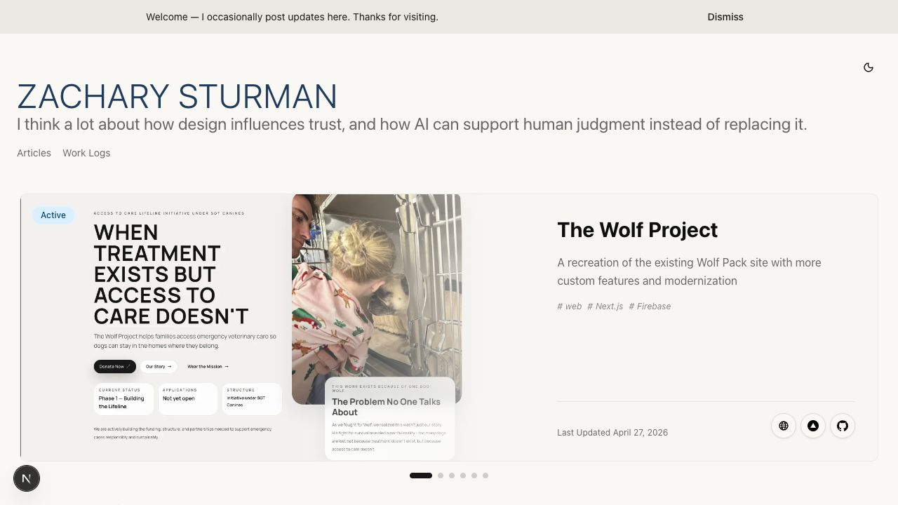
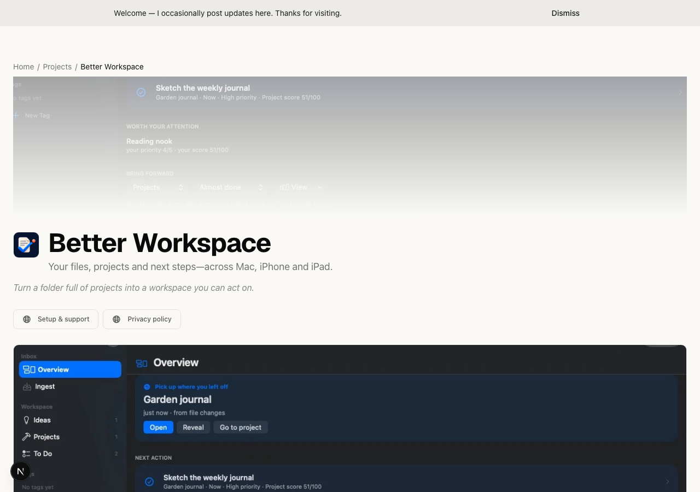

<!-- WORKSPACE-VERIFICATION:START -->

<!-- WORKSPACE-RECONCILIATION:2026-10-10 -->

Reconciliation 2026-10-10: [current details and actual task links](<docs/WORKSPACE_RECONCILIATION.md>) · [flow plans and scoped results](<docs/APP_FLOWS.md>). Historical audit instructions below retain their dates; the linked current records govern next work.

## Current state and getting started

Updated 2026-10-05. **A fast, content-rich portfolio for creative, scientific, and technical work.**

### Current state

Project type: **Web application**. Earlier assessment: **REVIEW REQUIRED** — Remove the specific environment/validation blocker, then verify the existing primary flow before extending scope.

| App | Platform | Observed startup |
|---|---|---|
| zachary-sturman | web | opened |

These are startup observations. Production readiness and the candidate user flows are not yet validated. Physical iPhone results apply only to the recorded device; watch simulator results do not establish physical-watch behavior.


### Install and start

#### zachary-sturman — web

Purpose: **A fast, content-rich portfolio for creative, scientific, and technical work.**

Requirements: Node.js, the declared package manager and any backend/services in the existing configuration.

Install and start from this project root:

```sh
cd .
npm ci --no-audit --no-fund
npm run dev -- --hostname 127.0.0.1 --port 4377
```

Audit entry URL: [http://127.0.0.1:4377](<http://127.0.0.1:4377>). Restart the server before reopening it; use any configured base path shown in this URL.

Expected result: the local server prints its URL and renders the zachary-sturman interface. Earlier audit servers may have been stopped after capture.

### Project map

- [package.json](<package.json>)
- [requirements.txt](<requirements.txt>)
- [worker/package.json](<worker/package.json>)
- [app/layout.tsx](<app/layout.tsx>)
- [app/page.tsx](<app/page.tsx>)
- [worker/src/index.ts](<worker/src/index.ts>)
- [AGENTS.md](<AGENTS.md>)
- [worker/README.md](<worker/README.md>)
- [docs/NEXT_STEPS.md](<docs/NEXT_STEPS.md>)

### Screenshots

**zachary-sturman (web, opened)**



### Next steps and Better Workspace

- **Next work:** zacharysturman — Unblock build validation in . (Better Workspace task `31869333-268d-5eec-9b56-1bc56997b9fb`).
- **Next Codex action:** Current startup follow-up: The app UI opened. Prepare and run the isolated candidate flows in docs/NEXT_STEPS.md with success/error/persistence assertions; startup alone does not establish release readiness. (Better Workspace task `31869333-268d-5eec-9b56-1bc56997b9fb`).
- **Next user action:** Review each app purpose and screenshot in README.md; choose the intended product, experiment, duplicate/consolidation candidate or archive candidate. No app is marked production-complete by startup alone. (Better Workspace task `9b48593f-3970-598d-a1fc-6e92d86cc4f8`).

Full continuation and candidate flow details: [next steps](<docs/NEXT_STEPS.md>).

No unambiguous row in the connected Notion projects database was matched. No new Notion row was created.

<!-- WORKSPACE-VERIFICATION:END -->
<div align="center">

# Zachary Sturman — Portfolio

**A fast, content-rich portfolio for creative, scientific, and technical work.**

[Live site](https://zacharysturman.com) · [Run, build & publish guide](docs/development-and-deployment.md) · [Architecture](#architecture) · [Service setup](#service-setup)

</div>

<br />

This repository is the source for [zacharysturman.com](https://zacharysturman.com): a statically exported Next.js site with project collections, articles, accessible media, and a small public JSON API. Content can be maintained locally or synchronized from Notion through the optional publishing pipeline.

> **Looking for the complete workflow?** Start with **[Run, build & publish the portfolio](docs/development-and-deployment.md)**. It covers local setup, builds, tests, GitHub pushes, the automatic production deployment, post-deploy verification, and the supporting email services.

## At a glance

| Area | Choice | What it does |
| --- | --- | --- |
| Site | Next.js 15 + React 19 | Static portfolio application exported to `out/`. |
| Hosting | Firebase Hosting | Serves the production site at `zacharysturman.com`. |
| Content | Notion + local files | Optional build-time synchronization for projects, articles, and media. |
| Forms & mail | Cloudflare Worker + Resend | Handles contact, newsletter interest, delivery reports, and analytics email. |
| Analytics | Firebase Analytics / GA4 | Privacy-conscious human-interest reporting; local, preview, and automated browsing are excluded before GA4 loads. |
| Media | Repository files, optional Cloudflare R2 | Keeps media local by default; R2 adds long-lived cached URLs when enabled. |
| Quality gates | Firebase deploy + local Playwright | Confirms the exact live release from this Mac, tests it, and stores evidence. |

## Better Workspace portfolio entry

The portfolio includes Better Workspace with a description, public README, real Mac/iPhone/iPad sample-data screenshots and dedicated support/privacy pages. Local content survives Notion regeneration. [Maintaining, previewing and releasing the entry](docs/BETTER_WORKSPACE.md).



## Quick start

**Requirements:** Node.js 20+ (Node 22 is used in CI), npm, and Python 3. Install Playwright’s Chromium browser only when you run browser or media tests.

```bash
git clone https://github.com/ZSturman/ZSDynamics-V5.0.git
cd ZSDynamics-V5.0
cp .env.example .env.local
npm ci
npm run dev
```

Open [http://localhost:3000](http://localhost:3000). The default `.env.local` leaves analytics and remote services disabled, so a regular local preview does not need credentials.

For the exact development, build, test, and GitHub publishing steps, see **[the operations guide](docs/development-and-deployment.md)**.

## Architecture

```text
                         ┌──────────────────────────────┐
                         │  Next.js static export (`out`) │
                         └──────────────┬───────────────┘
                                        │
                                        ▼
┌─────────────────────────────────────────────────────────────────────────┐
│ Firebase Hosting · zacharysturman.com                                    │
│ Portfolio UI · Firebase/GA4 analytics · read-only /api/*.json endpoints │
└─────────────────────┬───────────────────────────────────────────────────┘
                      │ form submissions / status reports
                      ▼
┌─────────────────────────────────────────────────────────────────────────┐
│ Cloudflare Worker · api.zacharysturman.com                               │
│ Contact + newsletter endpoints · Turnstile · KV rate limiting · Resend  │
└─────────────────────┬───────────────────────────────────────────────────┘
                      │
          ┌───────────┴────────────┐
          ▼                        ▼
┌──────────────────────┐  ┌─────────────────────────────────────────────┐
│ Resend                │  │ GitHub Actions                              │
│ Form + deployment     │  │ main push → deploy → live QA → previews    │
│ + analytics emails    │  │ daily GA4 summary → Worker → Resend         │
└──────────────────────┘  └─────────────────────────────────────────────┘

Optional: Cloudflare R2 at media.zacharysturman.com serves hash-versioned media.
```

## Common commands

| Command | Use it when… |
| --- | --- |
| `npm run dev` | You want the normal local Next.js development server. |
| `npm run build` | You want to build the already-committed site content into `out/`. |
| `npm run build:full` | You intentionally want to sync/generate content and media before building; it requires the Notion configuration and can modify generated files. |
| `npm run lint` / `npm run typecheck` | You want quick code-quality checks. |
| `npm run test:unit` / `npm run test:python` | You want focused JavaScript or Python pipeline coverage. |
| `npm run test:e2e` | You want local Playwright browser coverage. |
| `npm run test:media:smoke` | You want the fast desktop/mobile media check run by the pre-push hook. |
| `npm run test:all` | You want the full project test suite. |
| `npm run hooks:install` | You want Git to run the repository’s pre-push and post-push checks. |

Run `npx playwright install chromium webkit` before the first local browser/media run. The [operations guide](docs/development-and-deployment.md#testing) explains what each check covers and how production verification works.

## Publishing flow

1. Make and review a change locally.
2. Run the relevant tests, then commit and push it to `main`.
3. The **Deploy to Firebase Hosting on merge** workflow builds that exact commit and deploys it to Firebase’s live channel.
4. After Firebase updates, the local publisher confirms the deployment marker on Firebase and the custom domain, runs live Playwright QA against `https://zacharysturman.com`, and captures cross-browser previews.
5. The local publisher stores reports, screenshots/traces, and deployment evidence for 30 days, then sends a Resend dashboard report with the local captures attached.

Pushes from a feature branch do not publish production. A pull request from this repository receives a Firebase Hosting preview. Read the **[full publishing checklist and post-push behavior](docs/development-and-deployment.md#publish-to-github-and-production)** before your first release.

## Service setup

Each integration is optional for a plain local preview. Never commit `.env.local`, API keys, service-account JSON, or Worker secrets.

| Service | Used for | Setup guide |
| --- | --- | --- |
| Firebase + GA4 | Hosting, analytics, UTM-aware event tracking, daily metrics | [Analytics setup](docs/setup/analytics.md) |
| Cloudflare Worker | Contact form, newsletter interest, health checks, rate limiting, secure internal mail relay | [Worker setup](docs/setup/worker.md) |
| Resend | Contact delivery, newsletter-interest notifications, deployment reports, daily analytics summaries | [Email setup](docs/setup/email.md) |
| Cloudflare R2 | Optional public media hosting with immutable, content-hashed URLs | [R2 media setup](docs/setup/r2-media.md) |
| Notion | Optional build-time portfolio content source | [Publishing pipeline](docs/setup/portfolio-daily-publish.md) |

### Email and notifications

The site itself is static—email is deliberately handled outside Firebase:

- **Visitor forms:** the browser sends contact and newsletter-interest requests to the Cloudflare Worker. Turnstile, a honeypot, and KV-backed rate limiting help protect these endpoints; the Worker then sends through Resend.
- **Daily analytics:** GitHub Actions queries GA4 each day at 14:00 UTC, sends the rendered summary to the Worker, and the Worker sends it through Resend.
- **Deployment reports:** after Firebase updates a `main` deployment, this Mac emails a success report only after local live QA and preview capture pass. On a failure, it sends a prioritized report with the affected stage and retained evidence. An email-delivery problem is reported separately and never turns a successful deployment into a failed one.

## Documentation map

- **[Run, build & publish](docs/development-and-deployment.md)** — the practical end-to-end guide.
- [Notion schema & storage architecture](docs/notion-and-storage-architecture.md) — the six Notion
  databases, project/asset schema mapping, and the Project/Workspace/legacy media resolution model
  shared conceptually with the Better Projects app.
- [Analytics](docs/setup/analytics.md) — GA4, Firebase Analytics, custom dimensions, and daily reporting.
- [Email](docs/setup/email.md) — Resend domain verification and sending behavior.
- [Worker](docs/setup/worker.md) — endpoints, Turnstile, KV namespaces, and Worker secrets.
- [R2 media](docs/setup/r2-media.md) — enabling media uploads and cache-safe URLs.
- [Daily publisher](docs/setup/portfolio-daily-publish.md) — the Hammerspoon/Notion content-publishing automation, Git-state handling, and email severity/deduplication rules.
- [Article ingestion](docs/setup/articles.md) — the GitHub-sourced article pipeline, draft handling, and failure isolation.
- [Static JSON API](docs/api.md) — public endpoint shapes and caching.
- [UTM conventions](docs/utm-conventions.md) — campaign naming and ready-to-use URLs.

## License and use

This is Zachary Sturman’s personal portfolio. Its content, imagery, and project materials are not offered as a reusable template unless explicitly stated otherwise.
