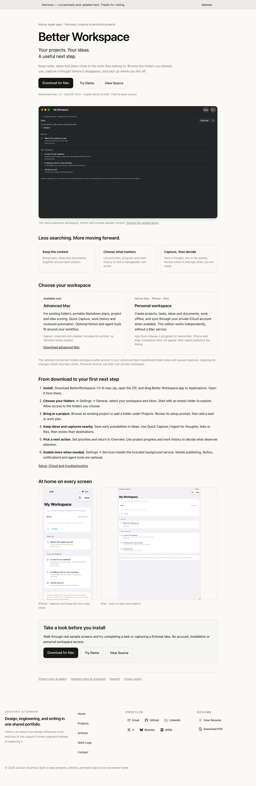
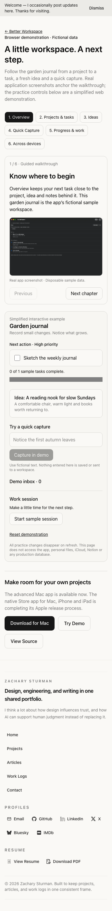

# Better Workspace portfolio and release

Updated October 15, 2026. Advanced Mac **1.0 (Build 8)** and the MIT-licensed public source are published. Apple submission needs the owner's expired App Store Connect sign-in; no public Store installation action is shown.

- [Project and gallery](https://zacharysturman.com/projects/better-workspace)
- [Product and getting started](https://zacharysturman.com/better-workspace)
- [No-account browser demo](https://zacharysturman.com/better-workspace/demo)
- [Advanced Mac release](https://github.com/ZSturman/Better-Workspace-Public/releases/tag/v1.0)
- [Public source](https://github.com/ZSturman/Better-Workspace-Public)
- [Setup and support](https://zacharysturman.com/better-workspace/support) · [Privacy](https://zacharysturman.com/better-workspace/privacy)

## Content and relationships

`content/projects/better-workspace/project.json` owns the project description, resource buttons and gallery. Its README is the public project story; `images/` contains actual sample-data captures and optimized variants. `lib/local_projects.py` merges these authored entries into cached manifests and public JSON endpoints without replacing unrelated records. It runs during the existing static build and Notion prebuild.

`app/better-workspace/page.tsx` provides the product overview, edition comparison and installation steps. `lib/better-workspace.ts` owns verified release URLs and Store status, and `components/better-workspace/release-actions.tsx` renders the primary actions. Support/privacy stay secondary. The advanced Mac requires macOS 14.4+ and includes arm64/Intel runtimes. The separate native Store experience supports Mac, iPhone and iPad with personal records and private iCloud. Connected folder workflows are optional and need the advanced Mac online to apply changes.

`app/better-workspace/demo/page.tsx` and `components/better-workspace/workspace-demo.tsx` combine six screenshot-led chapters with a simplified fictional practice workspace: task completion/progress, an idea, Quick Capture/inbox and a sample session. Practice state stays in React memory and clears on reset/refresh. It makes no app/account/workspace/Notion/iCloud connections. It is explicitly a web demonstration, not a native app running in the browser.

The public source is a clean snapshot in **Better-Workspace-Public**. The app's private development repository retains personal audit history. Never link visitors to the private remote or publish its history. The app repository owns artifact integrity, signing, notarization, Apple reviewer instructions and submission. This repository owns the visitor experience and existing Firebase deployment.

## Update content

```sh
npm run sync:local-projects
npm run build
npx playwright test -c playwright.release-verification.config.ts tests/better-workspace.spec.ts
```

Expected: canonical entry/media copied, static export succeeds and two 1280px/390px tests pass. These check project actions, actual image decoding, every demo chapter, completion/capture/session/reset/refresh, support/privacy routes, browser errors and overflow. TypeScript also passed during this launch. Required pre-push media smoke passed **33 tests**, with **5 optional skips**.

For screenshot changes, use real disposable native sample data. Keep sources in `content/projects/better-workspace/images/`; the latest project-editor image comes from the verified October 15 sample. Never use private workspace screenshots or fabricated native UI. Existing connected screenshots illustrate the unchanged connected experience; the personal screenshots represent the integrated Build 8 UI.

## Deploy and verify

Push to `main` using the existing hooks. `.github/workflows/firebase-hosting-merge.yml` calls the reusable Firebase production build/deploy workflow. Confirm success, then verify the actual site rather than assuming the local build shipped:

```sh
npx playwright test -c playwright.production.config.ts tests/production/better-workspace.spec.ts
```

Expected: eight responsive Chromium/WebKit checks across desktop/mobile browser projects. Automation suppresses GA4 before site scripts run. Live downloads are verified separately from the app repo with unauthenticated HTTP, exact SHA-256/byte comparison, strict signature, stapled-ticket and quarantined Gatekeeper checks. No personal app/service installation is changed.

Feature release commit: `2a29cc173aaa68981c3120a8665839ed6ff0bae7`.
Deployment: https://github.com/ZSturman/ZSDynamics-V5.0/actions/runs/38856283460.
Final live results are recorded in `docs/evidence/better-workspace-public-release-20261015.json`.

## Apple availability and follow-ups

Only add **Get on the App Store** after Apple's public listing actually resolves. Recheck the app's live App Store Connect platform statuses after sign-in and submission, then update `storeStatus` and the canonical project README. Do not equate uploaded/TestFlight/Prepare for Submission with submitted or live. Current App Store URL returns HTTP 404.

The app's remaining separate-user advanced-service install/login check and broader widget coverage are documented nonblocking follow-ups. Cloud sync is eventual. Keep support copy aligned with actual behavior, and preserve pre-existing unrelated local edits.




