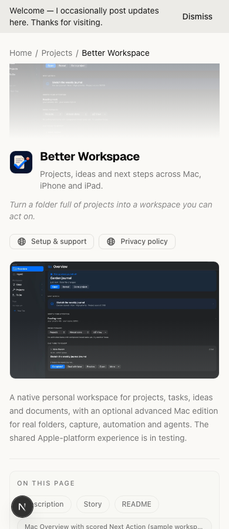

# Better Workspace portfolio entry

Updated October 15, 2026. The project page is live at https://zacharysturman.com/projects/better-workspace, with deployed support and privacy pages at `/better-workspace/support` and `/better-workspace/privacy`.

## Source and publishing

- `.gitignore`: only this authored content folder is included; generated/other content remains ignored.
- `content/projects/better-workspace/project.json`: public description, status, resources and screenshot gallery.
- `content/projects/better-workspace/README.md`: public project README shown in the portfolio; copied as a downloadable Markdown resource.
- `content/projects/better-workspace/images/`: actual Mac, iPhone and iPad sample-workspace captures, the app icon, and optimized variants. Sources came from the Better Workspace repository's documented UI captures, not generated mockups. The gallery retains the October 13 connected-workspace captures and adds October 14 shared personal-workspace previews: a window-only native Mac capture and physical iPhone/iPad Release captures. The new sample is editable and memory-only; live personal cloud sync is not enabled.
- `lib/local_projects.py`: merges local entries by ID/slug and copies assets. Existing unrelated exported records are preserved. This runs during the normal cached build and the staging step of the Notion prebuild, so a sync cannot erase the local entry. Static project API entries and site counts are kept current without changing article endpoints or the hosted URL map.
- `app/better-workspace/{privacy,support}/page.tsx`: public pages linked from inside the app. They are deployed and return 200 in production browser checks.

The app is described as in testing, with no download or App Store button until the signed/notarized Mac package and approved mobile listing actually exist. The advanced Mac build 4 includes its offline Python runtime and has passed notarization, stapling and quarantined Gatekeeper checks. A unique temporary launchd job also passed service health/save/restart/readback checks without touching the installed service. Actual clean-user login installation and cross-device acceptance still gate publication.

## October 15 cohesive experience update

The public copy now explains local personal planning, connected mobile workflows and
optional advanced Mac services separately. The README and support page describe first
use, installation and storage without promising unfinished live sync. Privacy text
includes the local SwiftData database and memory-only sample. No unverified download
or App Store button is added. All six gallery images are checked for loading at both
1280px and 390px. The source checkout preserves the newer Recallable changes on main.

Validation: production static build; 41 unit tests; focused local-project Python tests;
two desktop/mobile Better Workspace browser checks. The configured pre-push media
smoke and post-deploy live checks must also pass. Automation suppresses production
analytics. The new images are format-compressed real screenshots, not mockups.

## Local preview and checks

```bash
npm run sync:local-projects
npm run dev
```

Open `http://localhost:3000/projects/better-workspace`. Expected: description, story, README, Mac/iPhone/iPad images and functional support/privacy links.

```bash
.venv/bin/python -m pytest -q tests_python/test_local_projects.py tests_python/test_folio_prebuild.py
npx playwright test tests/better-workspace.spec.ts
npm run build
```

Expected: nine focused Python tests, two desktop/mobile browser checks and a static export including all three pages. Use a Python environment with the repo's testing dependencies if `.venv` is absent. Browser checks include image decoding in the screenshot gallery, README presence, release links and no horizontal overflow at 1280px/390px.

Publication follows the existing [development/deployment guide](development-and-deployment.md). The release candidate is rebased onto origin/main `2645537`, preserving Recallable and Hue. The production build, 41 unit tests, 168 Python tests (plus 10 subtests), and 41 browser tests passed; one browser test was skipped because its optional dataset was unavailable. The candidate checkout is `/tmp/better-workspace-portfolio-release-20261013`; publication is authorized and completed for these pages. Commit `21fa407473f2444699ed69054475645b36be8bbc` deployed through successful workflow `38648726890`; deployment metadata matched that commit. An initial overlapping preview/build run failed with missing generated `_document`; the serial production build passed. Run builds and preview tests sequentially. Only the scoped Better Workspace changes are committed from this isolated checkout. The original checkout retains its unrelated dirty work. Live Chromium and WebKit production tests each passed 10 checks; missing WebKit runtime was installed from Playwright's official distribution before the passing run. `tests/production/better-workspace.spec.ts` suppresses analytics before loading the live pages. The screenshots below show the deployed site.

The app has processed iOS 1.0/build 3 and saved its listing, pricing and screenshots. The universal Mac ZIP is Developer ID signed, notarized/stapled and accepted by Gatekeeper, including a quarantined extraction. Clean Mac installation and full TestFlight workflows remain acceptance gates, so the public page correctly keeps app availability in testing and has no unverified download button. Production CloudKit schema and a private unique-tag round trip passed; cross-device command acceptance is still pending. No app-store live link or Mac download is published in this website deployment.

## Update images or release availability

Replace only this entry's source images with verified app captures, then generate their variants without deleting originals:

```bash
.venv/bin/python lib/media-optimizer.py content/projects/better-workspace/images
npm run sync:local-projects
```

Use rooted public paths for standalone assets; gallery paths already point to actual optimized files. Keep the READMEs, support page, status and resource buttons consistent when the release is available. App Store submission and distribution signing live in the app repository's `docs/APP_STORE_RELEASE.md`.



