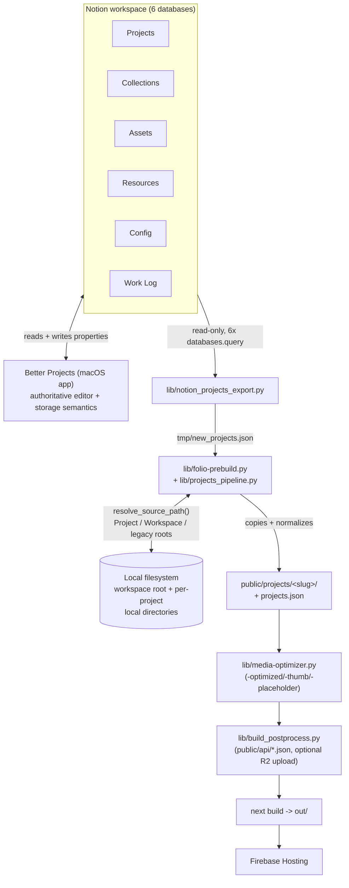

# Notion schema and storage architecture

This document explains how the portfolio's content pipeline (`lib/notion_projects_export.py` →
`lib/folio-prebuild.py` / `lib/projects_pipeline.py`) understands the Notion workspace, and how it
resolves project/asset media on disk. It exists because that understanding used to be implicit and
scattered — this is the single place that states it explicitly, including where the website's
model now matches the companion **Better Projects** macOS app (the source of truth for the storage
architecture) and where it deliberately still supports older data that predates that architecture.

See **[Run, build & publish](development-and-deployment.md)** for the build/deploy/QA lifecycle and
**[Daily publisher](setup/portfolio-daily-publish.md)** for the Hammerspoon automation. This document
is scoped to *what the six Notion databases mean* and *how a Notion-referenced file becomes a file
in `public/projects/`*.

## System overview

Project content is optionally authored in Notion (six databases) and in a companion native app,
**Better Projects** (`/Users/zacharysturman/Projects/Better Projects`), which is the primary editor
for that Notion workspace and — as of its current source tree — the authoritative definition of how
a Project's local directory and an Asset's storage location are supposed to work. The website does
not call Better Projects or depend on it running; it reads the same Notion databases directly and
implements a compatible (but independent) interpretation of the same fields, so a Notion schema
change only needs to be understood in one place conceptually, even though it's implemented twice.



## Sources of truth

| Concern | Source of truth | Notes |
| --- | --- | --- |
| Project existence, editorial metadata (status, domain, tags, dates, one-liner, summary) | **Notion Projects DB** | Edited directly in Notion or through Better Projects' Project tab. |
| Whether a project is public/eligible for the portfolio | **Notion Projects DB** (`public`, `in showcase` checkboxes) | See [Portfolio eligibility](#portfolio-eligibility). |
| A project's own local directory (for storage="Project" assets) | **Notion Projects DB** `Local Directory` (rich text) | A plain path string, not a filesystem grant — see [Security note](#security-note-paths-are-hints-not-grants). |
| An asset's storage kind and location | **Notion Assets DB** (`storage`, `relative path`, `storage project`) | See [Media architecture](#media-architecture). |
| The literal bytes of most images today | **Notion's `preview` files property** on each Assets DB row | Most real assets today are actually uploaded into Notion directly; the relative-path/storage fields are a secondary, not-yet-fully-populated signal. Notion-hosted URLs are short-lived and must be downloaded at build time, never linked to directly. |
| The shared workspace root's location on this machine | **Notion Config DB** `root path` (rich text) | Read as `config.root_path` by `lib/projects_pipeline.py`. See [Config DB note](#config-db-schema-note). |
| Per-project generated portfolio data (final shape served by the site) | **`public/projects/projects.json`** and **`public/api/*.json`** | Generated; never hand-edited. |
| Media that has already been imported into the repo | **`public/projects/<slug>/*`** on disk (git-tracked) | Treated as durable once present — see [Legacy compatibility](#legacy-compatibility). |

Better Projects also models **Resources** (repo/site links), **Collections** (asset/project
groupings), and a generic key/value **Configuration** database concept. The website reads
Resources and Collections the same way (via relations) but does **not** currently implement
Better Projects' generic Configuration schema — see the schema-drift note below.

## Project schema (Notion Projects DB → website)

Fetched live from the Projects database (267 rows total at time of writing; ~40 pass the
public+showcase filter). Fields the website's `lib/notion_projects_export.py` reads, by Notion
property name:

| Notion property | Type | Website usage | Better Projects usage |
| --- | --- | --- | --- |
| `title` | title | Project title | Same (`ProjectFieldKey` has no explicit title case; the title property is used directly) |
| `public` | checkbox | **Eligibility gate** (must be `true`) | `isPublic` |
| `in showcase` | checkbox | **Eligibility gate** (must be `true`) | `isInShowcase` |
| `summary`, `one liner`, `subtitle` | rich_text | Content | Same |
| `domain` | select | Content/filtering | Same |
| `Status`, `Phase` | select | Content | Same |
| `tags`, `mediums` | multi_select | Content | Same (`tags`; `mediums` is website-only today) |
| `started at`, `last update at` | date | Content dates | Same (`startedAt`/`lastUpdateAt`) |
| `featured`, `featured order` | checkbox / number | Homepage ordering | Same |
| `thumbnail`, `hero`, `banner`, `poster`, `icon` | relation → Assets | Primary media slots | Same (`ProjectFieldKey` specialized relations) |
| `assets` | relation → Assets | Additional gallery assets | Same (general relation) |
| `collections` | relation → Collections | Grouping | Same |
| `repo` | relation → Resources (or direct property, both supported) | Repository link/README fetch | Same fallback order (Resources DB preferred, direct property fallback) |
| `storage` | select (**no options defined yet — unused in practice**) | **Added by this audit** — read into `project.storage`, used only to decide whether a stray `Local Directory` value should be trusted (see below) | `ProjectStorageKind`: `Local` / `Remote` |
| `Local Directory` | rich_text (populated on 3 of 267 projects) | **Added by this audit** — read into `project.localDirectory`; used as the root for that project's `storage="Project"` assets | `DirectoryPropertyDetector` canonical field |
| `project slug` | rich_text (**empty on every sampled project**) | Not used — the website always derives the slug from the title (`normalize_project_slug`) | n/a |
| `required action`, `required asset action`, `action severity`, `asset action severity` | formula | Not used by the website (these drive Better Projects' own validation UI) | `ProjectValidation` parity display |
| `workspace roots`, `repo roots`, `path prefixes` | rich_text | Not used — legacy/plural hint fields predating the current per-asset model | Documented in Better Projects as "not a documented per-project directory association" |
| `hide from kiosk`, `tracking enabled`, `tracking priority`, `default scope`, `browser domains`, `allow automation`, `Automation Logs` | various | Not used by the website — unrelated automation/kiosk features living in the same database | n/a |

**Eligibility gate (exact filters sent to the Notion API):**

```python
public_filter = [_build_checkbox_filter("public")]
showcase_filter = [
    _build_checkbox_filter("in showcase"),
    _build_checkbox_filter("public"),
]
```

A project needs **both** `public` and `in showcase` checked to reach the portfolio at all — there is
no separate "draft" or "archived" carve-out beyond those two checkboxes today; `Status = Archived`
or `Deprecated` does **not** by itself exclude a project if both boxes are checked.

## Assets, Collections, Resources, Config, Work Log schemas

| Database | Notion properties the website reads | Notes |
| --- | --- | --- |
| **Assets** | `label` (title), `type`, `filename`, `relative path`, `storage`, `storage project`, `asset_id`, `projects`, `collections`, `preview` (files, via the generic raw-property fallback), `resources` | `storage`/`storage project`/`asset_id` were **not previously read at all** — see [Changes made](#what-changed-in-this-audit). `preview` carries the actual Notion-hosted file for ~90% of assets today. |
| **Collections** | `label` (title), `one liner`, `summary`, `items (projects)`, `items (assets)`, `thumbnail`, `resources`, `public` | Matches Better Projects' `CollectionFieldKey`. |
| **Resources** | `label`, `type`, `url`, `icon`, `projects`, `collections`, `assets`, `public` | Matches Better Projects' `ResourceIntegration` (normalized-DB preference, direct-property fallback). |
| **Config** | `root path` (rich_text), row title | See schema-drift note below — this does **not** match Better Projects' generic key/value `ConfigurationSchema`. |
| **Work Log** | most fields, filtered to `public == true` | Powers the "work logs" timeline shown per project; not part of storage/media resolution. |

### Config DB schema note

Better Projects' `ConfigurationSchema.swift` defines a generic key/value schema (title `"Key"`,
columns `"Value"`/`"Type"`/`"Category"`/`"Description"`, with canonical rows like
`workspace.location`, `database.projects`, etc.), gated behind a `useNotionConfigForSettings`
toggle that **defaults to off**. The live Config database does **not** use that schema — it has a
single bespoke `root path` rich-text column and a title that holds a date string (`_build_config`
picks the row whose title matches `YYYY-MM-DD`, using the lexicographically latest one, so multiple
dated snapshots can coexist). Treat this as **intentional schema drift, not a bug**: Better
Projects' generic Configuration integration isn't active in this workspace, and the website's
`config.root_path` reads the simpler, currently-real shape. If the Configuration database is later
migrated to Better Projects' generic schema, `lib/notion_projects_export.py`'s `_build_config` will
need a matching update — it is the only place that interprets Config rows.

## Media architecture

### The storage model

An Asset's `storage` property (Notion select) is one of:

- **`Project`** — `relative path` is relative to the root of the Asset's `storage project` relation
  (a specific Project's `Local Directory`). New assets created going forward use this or `Workspace`.
- **`Workspace`** — `relative path` is relative to the shared workspace root (`config.root_path` /
  Better Projects' "Workspace root").
- **`Local`** (legacy) — same resolution as `Workspace` in this codebase today. Better Projects
  distinguishes a separate legacy "shared Root Path" bookmark from the newer "Workspace root"
  bookmark on the Mac; the website only has one configured root (`config.root_path`), so both
  collapse onto it here. This is a deliberate simplification, not a bug — see
  [Remaining risks](#remaining-risks-not-fully-verified) in the final report if the two ever diverge.
- **unset, with a non-empty `relative path`** — treated as implicitly `Local`/`Workspace` (the same
  "legacy-implied" rule Better Projects itself uses for both Projects and Assets: a value with no
  explicit storage tag is not an error, it's the old convention).
- **unrecognized value** — never guessed; falls back to the shared root exactly like an unset value,
  and is safe by construction (an unknown select option cannot cause the resolver to crash).

At the time of this audit, **0 of 194 assets have `storage project` populated**, and only 1 has an
explicit `storage = Workspace` tag — the rest are untagged. This is expected: Better Projects only
recently added the `Project`/`Workspace` taxonomy, and most of today's real assets predate it. The
resolver therefore has to make the untagged, majority case work exactly as it always has, while
being ready for `storage="Project"` assets to start appearing.

### Resolution precedence (implemented in `lib/projects_pipeline.py`)

For a given asset reference (a dict with at least a `relativePath`/`path`/`filename`/`url` and,
when available, `storage` + `storageProjectId`), `resolve_source_path()` tries, in order:

1. **Absolute path, as given.** If the Notion-recorded path is already absolute (including old
   `/Users/.../Downloads/PORTFOLIO/...` paths from a previous machine/import), it is tried directly
   — this is the main legacy case today (many assets still carry these).
2. **Project-storage root + relative path**, when `storage == "Project"` and the named
   `storage project` resolves to a Project with an existing `Local Directory` on this machine
   (`configure_storage_project_roots()`, new in this audit). Tried **before** the shared root so a
   Project-storage asset can never be silently satisfied by a same-named file elsewhere.
3. **Shared root (`config.root_path`) + relative path.** This is the Workspace root, the legacy
   "Local" root, and the implicit root for any untagged asset — i.e. almost everything today.
4. **Unique-filename fallback.** If no candidate exists, search once (memoized per run) for a
   uniquely-named file anywhere under the applicable root(s) — this survives a project folder being
   renamed without every Notion path being updated, but refuses to guess when the filename isn't
   unique.
5. **Re-download from Notion.** If still missing, re-fetch the Asset's Notion page with the
   integration token (refreshing its short-lived signed file URL) and download the file — the
   integration token is never forwarded to the signed storage URL itself. If the live page can't be
   fetched (offline), the previously-exported (possibly expired) URL is tried as a last resort.
6. **Give up loudly.** If nothing worked, the build logs `⚠️ Missing source file. Tried: ...` (or,
   for a Project-storage asset, a message naming the storage project's root) and continues — a
   single missing asset never fails the whole build. Media that was already copied into
   `public/projects/<slug>/` on a previous run is untouched by this failure (see
   [Legacy compatibility](#legacy-compatibility)).

Every step above is unit-tested in `tests_python/test_projects_pipeline.py` (search for "storage" —
tests cover: Project-storage precedence with no cross-contamination against a same-named Workspace
file, Remote-project storage never used as a root even with a stray `Local Directory` value,
untagged/Workspace assets being unaffected by the change, and a `storage="Project"` asset whose
storage project has no resolvable root falling back gracefully instead of crashing).

### Worked examples (from the live database)

```
[storage] asset "09FF3610-...png"  storage=Workspace  relativePath="Projects/Transactions/Media/09FF3610-....png"
  -> resolves against config.root_path ("/Users/zacharysturman/Projects/PORTFOLIO")

[legacy]  asset "hero.png" (Marina Departure NOAA Risk Checker)  storage=<unset>
          relativePath="/Users/zacharysturman/Downloads/PORTFOLIO/Assets/NOAA/hero.png"
  -> absolute path no longer exists on this machine
  -> re-downloaded from Notion's "preview" file property (see resolve_source_path step 5)

[future]  asset with storage=Project, storageProjectId=<Signals project>
  -> resolves against that Project's own Local Directory, NOT config.root_path,
     even if config.root_path happens to contain a same-named file
```

### Security note: paths are hints, not grants

Matching Better Projects' own model: a `Local Directory` or `relative path` value in Notion is a
**plain, machine-agnostic string**, never a credential or filesystem authorization. The website's
build process runs locally (via the Hammerspoon publisher, on the same Mac that owns the files) with
whatever filesystem access the logged-in user already has — there is no separate grant mechanism to
manage or leak. Nothing resembling a security-scoped bookmark, token, or secret is ever written to
Notion by either system.

## Publishing lifecycle

See **[Run, build & publish](development-and-deployment.md)** for the full lifecycle (build,
test, commit, push, deploy, post-deploy QA, email). The Notion-specific slice of that lifecycle is:

```
fetch-notion-projects (lib/notion_projects_export.py, live-Notion, 6 databases, paginated, retried)
  -> tmp/new_projects.json
  -> lib/folio-prebuild.py --input-json tmp/new_projects.json
       -> lib/projects_pipeline.py: build_projects_from_json()
            - configure_storage_project_roots()   [new]
            - per-project normalization + resolve_source_path() per media role
            - copies resolved files into public/projects/<slug>/
       -> public/projects/projects.json
  -> npm run optimize (lib/media-optimizer.py: -optimized/-thumb/-placeholder variants)
  -> npm run postprocess (lib/build_postprocess.py: public/api/*.json, optional R2 upload)
```

`npm run fetch-notion-projects` supports `--dry-run` (fetches live, prints project/config counts,
writes nothing) for a safe check that credentials and database access still work without touching
any generated file. `scripts/portfolio-change-summary.mjs` (`npm run change-summary`) is the
authoritative "did anything meaningful change" diagnostic — it diffs the generated
`projects.json`/`articles.json` against a git ref, ignoring noisy generated timestamps, and is what
gates whether the daily publisher commits/deploys at all. `scripts/validate-portfolio-output.mjs`
(`npm run validate:portfolio`) is the authoritative post-build integrity check (unique ids/slugs,
every media reference resolves to a real file or one of its optimized variants, every route exists
in the static export, every internal link resolves).

## Legacy compatibility

Nothing about the new storage-aware resolution removes or changes existing behavior:

- Every asset without `storage`/`storage project` set (i.e. essentially all of them today) resolves
  **exactly as it did before this audit** — against `config.root_path`, with the same absolute-path,
  unique-filename, and Notion-redownload fallbacks.
- Media already copied into `public/projects/<slug>/` on a previous run and committed to the repo is
  never deleted by a resolution failure — a missing/unresolvable source only produces a warning; it
  does not remove or overwrite a file that already exists in the generated output unless a new,
  successfully-resolved source is found to replace it.
- The favicon cache (`public/icons/favicons/`) and link-preview screenshot cache
  (`public/projects/<slug>/previews/`) are untouched by this change and continue to work as
  existence-based (not hash-based) caches.

## Configuration

Relevant environment variables (see `.env.example` for the full list and current descriptions):

- `NOTION_API_KEY`, `NOTION_PROJECTS_DB_ID`, `NOTION_COLLECTIONS_DB_ID`, `NOTION_ASSETS_DB_ID`,
  `NOTION_RESOURCES_DB_ID`, `NOTION_CONFIG_DB_ID`, `NOTION_WORK_LOGS_DB_ID` — required for any
  Notion-backed build (`npm run generate-projects` / `npm run build:full`).
- `config.root_path` is **not** an environment variable — it comes from the Notion Config DB's
  `root path` property at fetch time, or can be overridden per-invocation with
  `python3 lib/folio-prebuild.py --root-path /some/path` for local testing.

No new environment variables were introduced by this audit — the storage-aware resolution reads
fields that were already being fetched from Notion (or are trivially added to the existing property
extraction) and requires no new configuration.

## Testing

- **Unit tests** (`npm run test:python`, excludes live Notion): `tests_python/test_projects_pipeline.py`,
  `tests_python/test_notion_projects_export.py`, `tests_python/test_sync_articles.py`. These are the
  executable spec for schema normalization, eligibility, and media resolution — including the new
  storage-aware tests described above.
- **Live integration tests** (`npm run test:python:integration`, real network calls to
  `api.notion.com`, requires `.env.local`): `tests_python/test_notion_integration.py`, including a
  `TestDryRun` class that runs the real export script with `--dry-run` and asserts it exits 0 without
  writing output.
- **JS unit tests** (`npm run test:unit`): `tests/portfolio-pipeline.test.mjs` covers the
  change-summary diff logic; others cover analytics.
- **Safe manual dry run** (no repo files touched): fetch live data to a scratch path with
  `python3 lib/notion_projects_export.py --output /tmp/preview.json`, then call
  `build_projects_from_json(input_json_path=..., temp_public_projects_root=<scratch dir>)` directly
  from a throwaway script pointed at a scratch output directory — this exercises the full
  normalization + media-resolution pipeline against live Notion data without ever writing to
  `public/projects/`.
